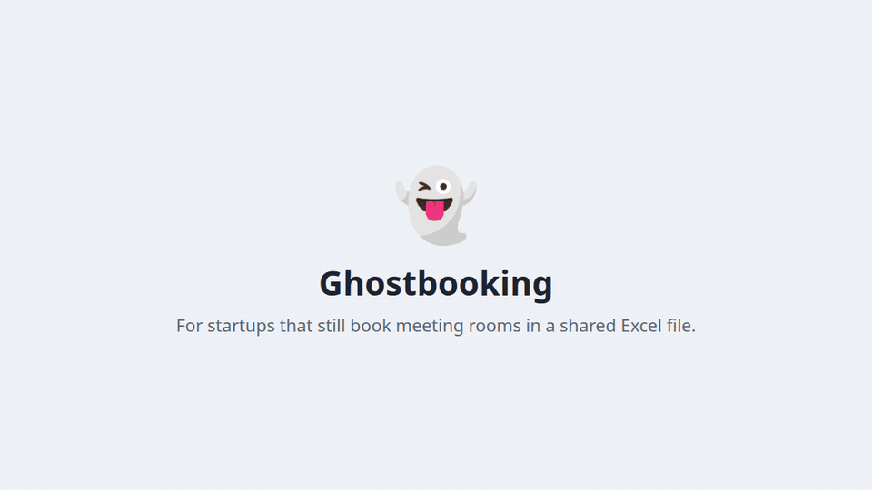

# 👻 Ghostbooking

**For startups that still book meeting rooms in a shared Excel file.**



Every morning, Ghostbooking clears the bookings people forgot to remove, tells people about double bookings with a free alternative, posts a short summary to the team, and reminds people before their meetings with one-click Keep / Release links. It works on Slack, Teams, Discord, email or any webhook. Nobody has to change how they book.


## Try it in 30 seconds

```bash
uv sync
uv run ghostbooking check -c examples/config.yaml --now "2026-11-23 07:30"
uv run ghostbooking tick  -c examples/config.yaml --now "2026-11-23 07:30" --dry-run
```

The example sheet has ghost bookings left over from Friday, a double booking, a recurring standup, a protected board meeting and a row with "tbd" as its end time.

## Excel, CSV or Google Sheets

Point `source` at your sheet and map your column names:

```yaml
source:
  type: excel            # excel | csv | gsheet
  path: /mnt/shared/Room bookings.xlsx
  sheet: Bookings
  columns: {room: Salle, date: Jour, start: Début, end: Fin, booked_by: Réservé par}
  label: Room bookings   # optional: the name people know it by, used in messages
  url: https://yourcompany.sharepoint.com/…   # optional: where people open it ("Open the sheet")
```

`path` is where Ghostbooking reads the file; `url` is where your team opens it (SharePoint, OneDrive, a shared drive link). With a `url`, team messages end with an **Open the sheet** link. Google Sheets get that link automatically.

**Google Sheets** (`pip install 'ghostbooking[google]'`):

1. In Google Cloud, create a project, enable the **Google Sheets API**, and create a **service account** with a JSON key.
2. Share the booking sheet with the service account's email (`client_email` in the JSON) as an **Editor**.
3. Configure it:
   ```yaml
   source:
     type: gsheet
     spreadsheet: https://docs.google.com/spreadsheets/d/…/edit   # the URL or just the ID
     sheet: Bookings
     credentials: service-account.json   # or set GOOGLE_APPLICATION_CREDENTIALS
   ```

People edit a Google Sheet live, so before deleting anything Ghostbooking fetches the rows again. If someone inserted, sorted or edited them in the meantime, it deletes nothing and tries again on the next pass. Each change is backed up as a CSV in `backups/` first.

## Safe on a shared file

- A backup before every write (the last 30 are kept).
- Never writes while someone has the file open in Excel or LibreOffice.
- Re-checks the file right before writing; if it changed, it does nothing.
- Only the booking rows move. Formatting, other sheets, column widths and frozen headers stay.
- Rows it can't read are reported and left alone.
- `--dry-run` shows what would change without writing anything.

## Telling people

Map the names in "Booked by" to people, and pick your channels in `config.yaml`:

```yaml
people:
  Karim: {slack: U01KARIM, email: karim@example.com, aliases: [KB]}
  Omar: {email: omar@example.com}

channels:
  - type: slack
    token: ${SLACK_BOT_TOKEN}   # read from the environment, never stored in the file
    team_channel: "#rooms"
  - type: email
    host: smtp.example.com
    sender: rooms@example.com
```

| Channel | Direct messages | Team channel |
|---|---|---|
| `slack` (bot token) | yes, to people with a `slack` ID | `team_channel` |
| `slack` (`webhook_url`) | no | the webhook's channel, with an @mention |
| `email` (SMTP) | yes, to people with an `email` | `team_email` |
| `teams` (Workflows webhook) | no | yes, name in bold, links as buttons |
| `discord` (webhook) | no | yes, with an @mention for people with a `discord` ID |
| `webhook` (JSON POST) | everyone, with their whole `people:` entry | yes |
| `console` | prints everything, sends nothing | |

- People who aren't in `people:`, or can't be reached directly, get their message in the team channel with their name on it. `ghostbooking check` lists them.
- Each message is sent once. If a channel fails, the others still go out, the failure is logged, and the next run tries again (exit code 3).
- `--dry-run` shows every message and where it would go.

## During the day

`ghostbooking run` does a pass every minute (or run `ghostbooking tick` from cron, Task Scheduler or GitHub Actions):

- **Morning reset** once per working day at `reset_at` (07:30 by default). `tick --reset` forces it.
- **Reminder** 10 minutes before each meeting: *"Reminder: Atlas, 14:00–15:00, starts in 10 minutes. Tap Keep by 14:15, or the room is released for others."*
- **Keep / Release links** in the reminder. If nobody taps Keep within 15 minutes of the start, the room is released and the person is told. Recurring and protected meetings are never auto-released.
- **Meetings that end** are removed from the sheet right away, so nobody wonders whether the room is still taken.

Links need `ghostbooking run` reachable by your team (`links.base_url`). Opening a link only shows a confirm page; the button does the work, so Slack previews and email link scanners can't release a room by accident. Links are signed and expire when the meeting ends. Without `links:`, reminders are plain text and bookings still free themselves when they end.

If the sheet is open in Excel, reminders still go out; changes wait until it's closed (exit code 2).

On Fridays at 16:00 (`notifications.weekly_summary`), the team gets the week in a few lines: meetings that freed their room on time, ghost bookings cleared, room time given back by early releases and no-shows, double bookings caught, and the busiest room.

## Running it for a team

**Docker** (scheduler + links):

```bash
docker build -t ghostbooking .
docker run -d --restart unless-stopped --user "$(id -u):$(id -g)" -p 8080:8080 \
  --env-file .env -v ./ghostbooking:/config -v "/path/to/shared folder":/data ghostbooking
```

`./ghostbooking/config.yaml` points at `/data/Room bookings.xlsx`; state, the audit log and backups are written next to the config, so they survive restarts. See also `compose.yaml`.

**Without a server:** run `ghostbooking tick` every 5 minutes from cron, Windows Task Scheduler or a GitHub Actions schedule, and leave `links:` out.

| Command | What it does |
|---|---|
| `ghostbooking check` | Reads the sheet and shows what it sees: bookings, unreadable rows, people it can't reach. Run this first. |
| `ghostbooking tick [--dry-run] [--reset]` | One pass of whatever is due now. |
| `ghostbooking run` | A pass every minute, plus the Keep/Release endpoint. |

Exit codes: 0 ok, 1 config or file error, 2 skipped because the file is open, 3 some messages failed.

Everything Ghostbooking removes or sends is written to `ghostbooking.log.jsonl`.

## Help with setup

Ghostbooking is free and MIT-licensed. If you'd rather have it installed for your team, adapted to your sheet, or connected to another tool, I do that as a fixed-price job: [mabenafia.vercel.app](https://mabenafia.vercel.app).
